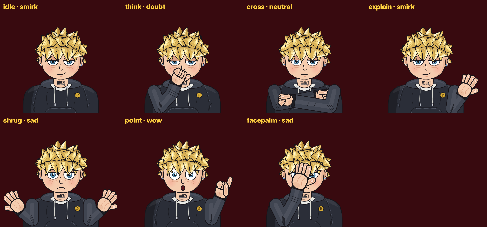

# Рассказчик канала «Чё по бабкам»

Постоянный персонаж-ведущий для всех роликов: внешность (рисуется кодом и анимируется) и голос (живая нейросетевая озвучка).



## Внешность

Молодой парень ~24 лет:
- светлые рваные объёмные волосы из отдельных прорисованных прядей в 3 слоя (тень, блик, внутренние линии, раздвоенные кончики), торчат в разные стороны;
- чёрно-белая тату-надпись **WUZI** готическим шрифтом на шее (Pirata One, `fonts/`, лицензия OFL; текст меняется в `TATTOO_TEXT`);
- тёмное худи с двойной строчкой, люверсами, шнурками с металлическими наконечниками, нашивкой-монетой «₽» и карманом-кенгуру, под ним белая футболка; руки в объёмных рукавах;
- голубые глаза с тяжёлыми веками — скептичный прищур; веснушки;
- маленькие серьги-гвоздики в обеих мочках: голубые камни огранки «бриллиант» в оправе с четырьмя крапанами, с цветными искрами и мерцанием.

Стиль: плоская мультяшная графика, чёрный контур 7 px, мягкие тени.

| Цвет | RGB |
|---|---|
| Волосы | (0.96, 0.84, 0.47), тень (0.80, 0.63, 0.28) |
| Кожа | (0.96, 0.80, 0.68), тень (0.87, 0.64, 0.52) |
| Худи | (0.17, 0.18, 0.22), рукава (0.25, 0.27, 0.32) |
| Глаза | (0.36, 0.60, 0.74) |
| Тату | надпись WUZI, чёрная с серой растушёвкой |

**Позы** (`pose`): `idle`, `think` (кулак у подбородка), `cross` (руки скрещены), `explain` (открытая ладонь), `shrug` (разводит руками), `point` (указывает пальцем вверх), `facepalm` (ладонь на лице).

**Эмоции** (`emo`): `neutral`, `doubt`, `smirk`, `wow`, `sad`, `happy`, `angry` — см. `sheet_emotions.png`.

Анимация в `state`:
- `t` — время: дыхание, моргание, колыхание волос;
- `level` 0..1 — открытие рта по громкости голоса;
- `look` −1..1 — куда смотрит;
- `tilt` — наклон головы.

## Главное правило

Рассказчик используется во всех видео и **всегда живой**: говорит, мимичен, активно показывает руками.

Для кадров с речью вызывай `narrator.perform(t, level, pose, emo)` — функция сама:
- меняет жест каждые ~2,5 с;
- подстраивает мимику под эмоцию фразы;
- кивает и наклоняет голову в такт словам;
- двигает рот по громкости голоса.

```python
narrator.draw(ctx, x, bottom_y, scale, narrator.perform(t, mouth_level, "explain", "doubt"))
```

## Как использовать

### В коде (pycairo)

```python
import sys; sys.path.insert(0, "videos/narrator")
import narrator
narrator.draw(ctx, x_center, bottom_y, scale, {"pose": "point", "emo": "wow", "t": t, "level": mouth})
```

Пример полного видеопайплайна (сцены, озвучка, губы по голосу, рендер): `videos/kvartira/`.

### Картинками (обложки, CapCut, Remotion, Canva)

- Готовые PNG с прозрачным фоном лежат в `sprites/` (по одному на позу, высота 1400 px).
- Любая комбинация: `python3 export.py --pose shrug --emo angry --height 2000 --out me.png`.
- Перевыгрузить все: `python3 export.py`.

## Голос

- **Модель:** [ESpeech-TTS-1 podcaster](https://huggingface.co/ESpeech/ESpeech-TTS-1_podcaster), лицензия Apache-2.0. Это F5-TTS, обученная на живой разговорной речи.
- **Ударения:** RUAccent.
- **Тембр** берётся с образца `voice/ref.wav`: молодой парень из Mozilla Common Voice, лицензия CC0 (общественное достояние). Запасной голос — `voice/ref_alt.wav`, пример звучания — `voice/sample_main.mp3`.

Озвучить текст:

```bash
python3 say.py "Короче. Я тут сел и посчитал, сколько стоит однушка." out.wav
python3 say.py "Семнадцать миллионов?! За однушку?!" shout.wav --shout
```

`say.py` генерирует текст по предложениям. Каждое предложение проверяет Whisper; если расслышал не то, генерирует заново, до 3 попыток.

**Советы:**
- пиши текст строчными буквами: КАПС модель коверкает, крик делается флагом `--shout`;
- числа пиши словами;
- аббревиатуры пиши как произносятся: «цэ-бэ».

Скорость на 4-ядерном процессоре — около 10 секунд речи за минуту.

Свой голос: положи 6–9 секунд чистой записи в `voice/ref.wav`, а её точный текст — в `voice/ref.wav.txt`.

## Зависимости

Шрифт тату: `cp fonts/PirataOne-Regular.ttf ~/.local/share/fonts/ && fc-cache -f` (иначе надпись будет обычным шрифтом).


`pycairo`, шрифт Inter (для подписей на листах).

Для голоса: `torch` (CPU), `f5-tts`, `ruaccent`, `faster-whisper`, `num2words`, `soundfile`, ffmpeg с `rubberband`.

Модели скачиваются при первом запуске.
